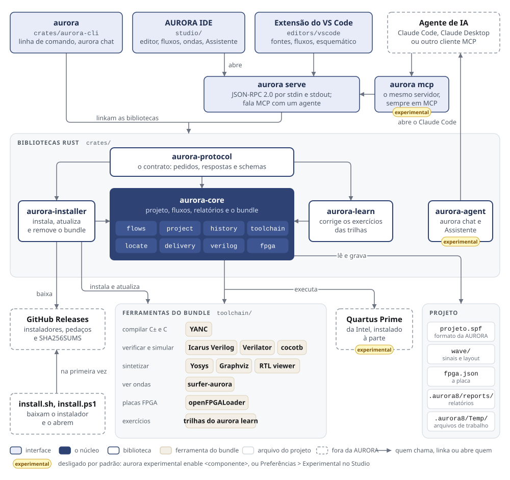

<h1 align="center">
  <picture>
    <source media="(prefers-color-scheme: dark)" srcset="studio/public/brand/lace-lockup-reverse.svg">
    
  </picture>
</h1>

<p align="center">
  <a href="https://github.com/ART3121/lace/releases"></a>
  <a href="https://nipscern.com"></a>
</p>

<p align="center">
  
  
  
</p>

Orquestrador do desenvolvimento em Verilog e de processadores SAPHO, o
processador soft-core do NIPS-CERN (UFJF). Cria projetos, compila C± e C com
o YANC, verifica e simula com Icarus Verilog e Verilator, sintetiza com
Yosys, desenha o esquemático com Graphviz e abre as ondas no surfer-aurora.

Duas interfaces sobre o mesmo núcleo (`aurora-core`): a linha de comando
`aurora` e a [AURORA IDE](studio/README.md), o ambiente gráfico (editor,
compilação, simulação e ondas numa janela), em `studio/`. O instalador
traz os dois. Para quem prefere o VS Code, a
[extensão do Lace](editors/vscode/README.md) usa a linha de comando e se
instala à parte ([abaixo](#extensão-do-vs-code)).

O Lace só executa as ferramentas do bundle instalado com ele, nas versões
exatas do bundle (ver [docs/BUNDLE.md](docs/BUNDLE.md)). No Linux e no macOS
o bundle acompanha o OSS CAD Suite, e a exceção é o Verilator, que compila
com o compilador C++, o `make` e o Perl do sistema. No Windows o Icarus e o
Verilator, com o compilador, vêm do bloco MSYS2 do
[lace-toolchain](https://github.com/ART3121/lace-toolchain).

Plataformas: Linux x64 (glibc 2.35: Ubuntu 22.04, Debian 12, Fedora 36,
Arch ou mais novos), macOS 13 ou mais novo em Apple Silicon, Windows 10 e
11 x64.

## Instalar

No Linux, a AURORA IDE usa o webkit2gtk 4.1 do sistema, que o instalador
não traz. O GNOME costuma já tê-lo; o KDE Plasma, o Arch e os ambientes
leves, em geral, não. Sem ele, a IDE não abre. Instale antes, ou deixe o
instalador oferecer no fim:

```sh
sudo apt install libwebkit2gtk-4.1-0     # Debian, Ubuntu, Mint
sudo dnf install webkit2gtk4.1           # Fedora
sudo pacman -S webkit2gtk-4.1            # Arch, Manjaro
```

Linux x64 e macOS Apple Silicon, em qualquer shell (bash, zsh, fish):

```sh
curl -fsSL https://raw.githubusercontent.com/ART3121/lace/main/install.sh | sh
```

Windows 10 e 11, no PowerShell:

```powershell
irm https://raw.githubusercontent.com/ART3121/lace/main/install.ps1 | iex
```

O script baixa o instalador da última release, confere o SHA-256 com o
`SHA256SUMS` da release e o abre: a instalação guiada no terminal no Linux e
no macOS, o assistente no Windows. Nos dois, primeiro se escolhe um perfil
(abaixo): o **SAPHO** é o recomendado, e o **Custom**, para uso avançado,
deixa marcar os componentes. O assistente do Windows pergunta antes o
idioma, inglês ou português. No Linux e no macOS,
instala em `~/.local/share/lace`, com o atalho `~/.local/bin/lace`. O Lace
Studio entra no menu de aplicativos.

Sem perguntas (scripts, laboratórios, CI):

```sh
curl -fsSL https://raw.githubusercontent.com/ART3121/lace/main/install.sh | sh -s -- --yes
curl -fsSL https://raw.githubusercontent.com/ART3121/lace/main/install.sh | sh -s -- --yes --profile verilog
curl -fsSL https://raw.githubusercontent.com/ART3121/lace/main/install.sh | sh -s -- --yes --components yanc,icarus,verilator
```

```powershell
$env:LACE_SETUP_ARGS = "/VERYSILENT /SUPPRESSMSGBOXES /CURRENTUSER /TYPE=sapho /TASKS=path"
irm https://raw.githubusercontent.com/ART3121/lace/main/install.ps1 | iex
```

Sem o script, direto da [página da release](https://github.com/ART3121/lace/releases/latest):

```sh
curl -fLO https://github.com/ART3121/lace/releases/download/v0.9.0/lace-0.9.0-linux-x64.tar.gz
tar xzf lace-0.9.0-linux-x64.tar.gz && ./lace-0.9.0-linux-x64/install
```

No macOS, troque `linux-x64` por `darwin-arm64`. Baixe pelo `curl`, não
pelo navegador: o instalador não é assinado, e o macOS recusa abrir um
arquivo baixado pelo navegador (ver [docs/INSTALL.md](docs/INSTALL.md)).

Para remover o Lace com o bundle inteiro: `aurora uninstall`.

### Perfis e componentes

A instalação começa por um perfil, que marca os aplicativos de um tipo de
trabalho; a lista inteira aparece, com os do perfil marcados e travados. O
Lace (CLI & Core) vem sempre.

| Perfil | Para quem | Deixa de fora |
|---|---|---|
| **SAPHO** (recomendado) | quem constrói processadores SAPHO e os programa em C± | nada |
| **Verilog** | quem projeta em Verilog sem processadores SAPHO | YANC |
| **Custom** (avançada) | uso avançado, para quem sabe de quais componentes precisa | o que não for marcado |

| Componente | O que é |
|---|---|
| AURORA IDE | o ambiente gráfico; no Linux precisa do webkit2gtk 4.1 do sistema |
| YANC | compiladores C± e C do SAPHO e a biblioteca SAPHO |
| Icarus Verilog | simulador Verilog, o padrão do `aurora sim`, e a verificação do `aurora check` |
| Verilator | simulador compilado e o `aurora check --lint`; no Linux e no macOS precisa de `g++` ou `clang++`, `make` e Perl do sistema, no Windows vem com eles |
| cocotb | testbenches em Python, com o Python que os roda; precisa do Icarus. O Lace roda os testes no Icarus (`aurora sim test_x.py`, ou Wave e Rápida no Studio) e, com o componente Verilator, no Verilator (`aurora sim --verilator`) |
| Yosys | síntese; lê as portas para o testbench-modelo do `aurora add` |
| Graphviz (dot) | desenho do esquemático; precisa do Yosys |
| surfer-aurora | visualizador de formas de onda |
| openFPGALoader | gravador de placas FPGA pelo cabo USB; o Lace ainda não o chama (as placas Intel são gravadas pelo `quartus_pgm` do Quartus) |
| Lace Learn | exercícios de Verilog corrigidos a cada gravação, no estilo do rustlings (`aurora learn`, e a vista Exercícios do Studio); precisa do Icarus |
| RTL viewer | o esquemático interativo do netlist da síntese, no navegador (`aurora synth --open`); precisa do Yosys |

Para instalar um aplicativo do bundle depois, sem reinstalar o Lace:
`aurora install`, que abre a lista no terminal, ou `aurora install verilator`.
Para ver se há versão nova do Lace e das ferramentas: `aurora update --check`.

Detalhes, remoção e problemas conhecidos: [docs/INSTALL.md](docs/INSTALL.md).
Quem tem o Solar 0.1.0 (o nome anterior do Lace) desinstala o Solar antes:
[docs/INSTALL.md, Quem tem o Solar 0.1.0](docs/INSTALL.md#quem-tem-o-solar-010).

### Extensão do VS Code

A extensão ainda não está no Marketplace: o arquivo dela,
`lace-vscode-<versão>.vsix`, vai anexado à release do Lace. Ela precisa do
Lace instalado (acima) e do VS Code 1.90 ou mais novo.

```sh
curl -fLO https://github.com/ART3121/lace/releases/download/v0.9.0/lace-vscode-0.1.0.vsix
code --install-extension lace-vscode-0.1.0.vsix
```

No Windows, os mesmos dois comandos no PowerShell, com `curl.exe` no lugar
de `curl`. Sem o terminal: baixe o `.vsix` da
[página da release](https://github.com/ART3121/lace/releases/latest) e, no
VS Code, abra Extensões, o menu `...` e **Install from VSIX...**. Para
atualizar, instale o `.vsix` novo do mesmo jeito; para remover, desinstale
pela aba Extensões.

A extensão ativa numa pasta com `.spf` e procura o `aurora` no `PATH`. Se o
VS Code não o achar (no Linux e no macOS, aberto pelo menu do sistema, ele
pode não ver o `~/.local/bin`), ponha o caminho do executável na
configuração `lace.path`. O que ela faz, e o que cada versão do Lace
habilita: [editors/vscode/README.md](editors/vscode/README.md).

## Depois de instalar

```sh
aurora tools --verify        # o bundle, as versões e a conferência dos hashes
```

Um projeto do Lace é Verilog; processadores SAPHO são uma etapa a mais, que
o YANC compila antes de verificar, simular ou sintetizar. Verilog:

```sh
aurora new contador
cd contador
aurora add contador.v        # cria o módulo e o registra como topo
aurora add contador_tb.v     # cria o testbench, que já instancia contador
aurora check                 # Icarus: o design e cada testbench
aurora hierarchy             # a árvore de instâncias do design e do testbench
aurora sim                   # simula e mostra o que o testbench escreve, enquanto roda
aurora wave                  # abre a onda no surfer-aurora
```

Um testbench sem `$finish` não termina sozinho: o Ctrl+C encerra a
simulação, e `aurora sim --timeout 30` a encerra depois de 30 s.

Processador SAPHO:

```sh
aurora new demo
cd demo
aurora proc add filtro       # cria filtro/filtro.cmm
aurora build                 # C± -> Verilog, memórias e testbench, pelo YANC
aurora sim -p filtro         # simula e mostra as saídas
aurora wave -p filtro
```

Cada `build`, `check`, `sim` e `synth` grava um relatório no projeto
(`.aurora8/reports/`): a máquina, as ferramentas e versões, o tempo de cada
passo e, na síntese, as estatísticas do Yosys:

```sh
aurora synth                 # sintetiza e grava o relatório
aurora report                # o relatório mais novo
aurora report list           # todos, do mais novo para o mais antigo
aurora report compare        # o mais novo contra o anterior comparável
```

Os projetos seguem a estrutura do YANC 7.1: o fonte e os valores de entrada
ficam na pasta do processador (`filtro/filtro.cmm`, `filtro/input_0.txt`,
um valor por linha), e tudo o que o YANC gera, com as saídas da simulação,
em `filtro/filtro/`. Um projeto da estrutura antiga (`Software/`,
`Hardware/`, `Simulation/`) é convertido com `aurora convert`, ou pelo Studio
ao abri-lo. Para mover ou renomear um
arquivo do projeto sem tirá-lo do `.spf`, use `aurora move` (`aurora move
contador.v rtl/`). Caminhos na linha de comando são relativos ao diretório
atual do shell. A referência da linha de comando,
com as regras de cada fluxo, está em [docs/CLI.md](docs/CLI.md).

Para outro programa (uma extensão de editor, um script), todo comando aceita
`--json`, um objeto no fim, e `--events`, um objeto JSON por linha enquanto
as ferramentas rodam. O formato de cada um está em
[docs/schema/](docs/schema/), gerado do código.

## Como as partes se ligam

<p align="center">
  <a href="docs/img/mapa.svg">
    <picture>
      <source media="(prefers-color-scheme: dark)" srcset="docs/img/mapa-escuro.svg">
      
    </picture>
  </a>
</p>

A linha de comando `aurora` linka as bibliotecas e chama as funções do
`aurora-core`. Os outros programas falam com um processo filho, o servidor do
Lace (`aurora serve`), por JSON-RPC: a AURORA IDE, que o abre sozinha, a
extensão do VS Code e scripts. Os pedidos e as respostas são os do crate
`aurora-protocol` ([docs/PROTOCOL.md](docs/PROTOCOL.md)). Um agente de IA
fala com o mesmo servidor em MCP: o `aurora serve` reconhece o idioma pelo
primeiro pedido, e o `aurora mcp` é o mesmo servidor, sempre em MCP
([docs/CLI.md](docs/CLI.md#a-api-para-outros-programas-lace-serve-e-lace-mcp)).
O `aurora chat` e a vista Assistente do Studio usam o `aurora-agent`, que abre o
Claude Code com o `aurora mcp`. O `aurora mcp`, o `aurora chat` e a vista
Assistente são experimentais: só funcionam depois de
`aurora experimental enable assistant`.

## Documentação

| Documento | Para quê |
|---|---|
| [docs/INSTALL.md](docs/INSTALL.md) | instalar, mudar componentes, remover |
| [studio/README.md](studio/README.md) | a AURORA IDE: usar, compilar, a documentação dela (`studio/docs/`) |
| [editors/vscode/README.md](editors/vscode/README.md) | a extensão do VS Code: o que faz, configurações, compilar e testar |
| [docs/CLI.md](docs/CLI.md) | a linha de comando `aurora` |
| [docs/LEARN.md](docs/LEARN.md) | os exercícios do `aurora learn`: fazer e escrever |
| [docs/FPGA.md](docs/FPGA.md) | as placas FPGA pelo Quartus Prime, um componente experimental (`aurora experimental enable fpga`) |
| [docs/API.md](docs/API.md) | a API do `aurora-core`, que a CLI e o `aurora serve` usam |
| [docs/PROTOCOL.md](docs/PROTOCOL.md) | cada método do `aurora serve` e do `aurora mcp`, com os parâmetros, o resultado, as notificações, os erros e os tipos; gerado dos tipos |
| [docs/BUNDLE.md](docs/BUNDLE.md) | o que vem no bundle, como montá-lo e o que vem do sistema |
| [docs/schema/](docs/schema/) | o JSON Schema do `--json` e do `--events` de cada comando e o do protocolo do `aurora serve` (`protocol-request.json`, `protocol-response.json`) |
| [docs/RELEASE.md](docs/RELEASE.md) | as releases: que número cada uma recebe, quando lançar e o passo a passo |
| [CONTRIBUTING.md](CONTRIBUTING.md) | como contribuir: preparar a máquina, onde mudar o quê, o que conferir |
| [docs/METODOLOGIA.md](docs/METODOLOGIA.md) | como o código se organiza e como a API muda sem quebrar quem a usa |
| [CHANGELOG.md](CHANGELOG.md) | mudanças por versão |

## Compilar do fonte

```sh
cargo build --release
python3 scripts/bundle.py --out dist/toolchain     # o bundle de ferramentas, com o Studio
target/release/aurora tools --toolchain dist/toolchain --verify
```

O Studio sozinho, para desenvolver: `cd studio && npm install && npm run tauri dev`
([studio/docs/DEVELOPMENT.md](studio/docs/DEVELOPMENT.md)).

No Linux, antes de rodar o Studio do código-fonte, instale as dependências do Tauri:

```sh
# Ubuntu / Debian
sudo apt update
sudo apt install build-essential curl wget file libwebkit2gtk-4.1-dev libxdo-dev libssl-dev libayatana-appindicator3-dev librsvg2-dev

# Fedora
sudo dnf install webkit2gtk4.1-devel openssl-devel curl wget file libappindicator-gtk3-devel librsvg2-devel
sudo dnf group install c-development
```

O que montar o bundle exige está em [docs/BUNDLE.md](docs/BUNDLE.md).

## Licença

O Lace e a AURORA IDE estão sob a licença MIT ([LICENSE](LICENSE)).
As ferramentas do bundle (YANC, Icarus Verilog, Verilator, cocotb, Yosys,
Graphviz, surfer-aurora, openFPGALoader) seguem as licenças delas. O
Quartus Prime não vem com o Lace: cada um instala o seu, sob a licença da
Intel.

NIPS-CERN, Núcleo de Instrumentação e Processamento de Sinais, Faculdade de
Engenharia da UFJF. <https://nipscern.com>
